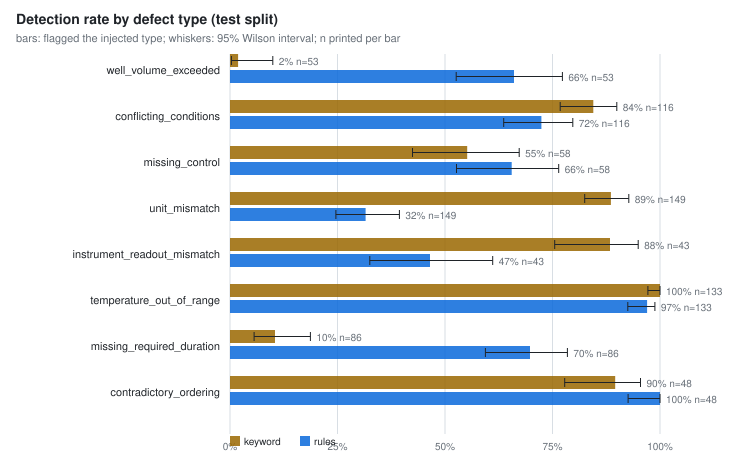

# platelint

Checks plain-language experiment requests for plate-based assays against physical
constraints, and measures how well that checking works.

A rule checker that parses plate formats, volumes, temperatures, units, controls,
readouts and step order beats a one-line keyword baseline on four of eight defect
types and loses on the other four, worst on unit mismatches at 32.3 percent
against 89.8 percent (n = 186). Both flag at least one problem in over 84 percent
of un-injected requests (n = 196), so neither works as a filter yet.



## Results

Test split, 74 of 98 protocols, 95 percent Wilson intervals. A hit means the
checker flagged the injected type.


| defect type | keyword | rules | n |
|---|---|---|---|
| well_volume_exceeded | 1.6% [0.3-8.3] | 71.9% [59.9-81.4] | 64 |
| conflicting_conditions | 85.3% [78.6-90.2] | 72.0% [64.2-78.7] | 143 |
| missing_control | 52.0% [40.9-62.9] | 68.0% [56.8-77.5] | 75 |
| unit_mismatch | 89.8% [84.6-93.4] | 32.3% [26.0-39.3] | 186 |
| instrument_readout_mismatch | 88.5% [77.0-94.6] | 40.4% [28.2-53.9] | 52 |
| temperature_out_of_range | 100.0% [97.7-100.0] | 97.0% [93.1-98.7] | 166 |
| missing_required_duration | 11.7% [7.0-19.0] | 73.9% [65.0-81.1] | 111 |
| contradictory_ordering | 87.0% [75.6-93.6] | 100.0% [93.4-100.0] | 54 |

Flagged at least one type on un-injected requests: keyword 88.3 percent
[83.0-92.1], rules 84.2 percent [78.4-88.6], n = 196.

## Method

99 CC BY protocols for ELISA, qPCR, cell viability and bacterial growth curves,
63 from Europe PMC and 36 from protocols.io, licence and URL per protocol in
`data/sources_all.csv`. Four models rewrote each as a request to a lab, under one
prompt that says nothing about volumes, units, controls or instruments:
gemini-3.5-flash-lite (99 requests), gpt-oss-120b (66), gpt-oss-20b (61),
gemini-3.5-flash (32). Free-tier quotas set those counts.

A script injects one defect per pair from the eight types in `03_defects.py`,
keeping only edits with exactly one diff hunk: 1105 pairs from 258 requests. The
LLM judge has not been run. Protocols split 30 percent tuning, 70 percent test by
hashed id, so none appears in both.

## Limitations

84 percent is an upper bound. An un-injected request is un-edited, not verified
correct, so a model that genuinely drops a no-template control counts here as a
flag. Rules fire `missing_control` on 56.1 percent of un-injected requests
(n = 196). Only hand labels separate false alarms from real errors, and the
blinded sheet for 60 requests in `data/labels_sheet.md` is unlabelled, so defect
rate per model is unreported.

Injected defects measure the checker against mistakes the taxonomy chose, not
mistakes models make unprompted. `missing_control` is the only type injected by
deletion, which a checker asking whether a control is named catches almost by
construction, so its rate is not comparable.

Injector and checker share one well-capacity table (`WELL_MAX_UL`), so a
`well_volume_exceeded` hit partly tests that they agree; injection overshoots
threefold. Sampling is not seed-reproducible since these APIs reject sampling
parameters; raw responses are kept in `data/requests/raw/`. Four responses were
dropped for hitting the 4096-token cap or returning nothing. gemini-3.5-flash is
excluded from the label sheet, where its 32 requests would give about 4 of 60
items.

## Reproduce

Python 3.11 or newer, standard library only. Free keys from
[Google AI Studio](https://aistudio.google.com/apikey) and
[Groq](https://console.groq.com/keys). Numbers come from `results/summary.json`.

```bash
python3 01_collect_sources.py
python3 01b_collect_protocolsio_meta.py
PROTOCOLS_IO_TOKEN=... python3 01e_fetch_protocolsio_text.py
python3 01d_merge_sources.py
GOOGLE_API_KEY=... GROQ_API_KEY=... python3 02_write_requests.py
python3 04_make_pairs.py
python3 06_check.py --checker keyword
python3 06_check.py --checker rules
python3 05_make_labels.py
python3 07_report.py
```
